<div align="center">

  <!-- HERO BANNER: INVERTOCAT DUALITY ASCII -->
  

  <br/><br/>

  # <code>&gt; whoami --all</code>
  
  <p align="center">
    <strong>🎓 3rd Year Computer Engineering Student</strong><br/>
    🛡️ <strong>Focus:</strong> SOC Operations, Blue Team Defense &amp; Vulnerability Research<br/>
    🐍 <strong>Core:</strong> Python Automation, Systems Programming &amp; Artificial Intelligence
  </p>

  <!-- QUICK STATUS BADGES -->
  <p align="center">
    
    
    
  </p>

</div>

---

### 🛠️ <code>[SECURITY_STACK &amp; ARSENAL]</code>

<div align="center">

#### 🛡️ Cybersecurity &amp; SOC Tools
[](https://www.wireshark.org/)
[](https://wazuh.com/)
[](https://www.splunk.com/)
[](https://www.kroll.com/)
[](https://nmap.org/)
[](https://portswigger.net/burp)
[](https://www.metasploit.com/)

#### 🐍 Languages &amp; Systems
[](https://www.python.org/)
[](https://www.gnu.org/software/bash/)
[](https://archlinux.org/)
[](https://isocpp.org/)
[](https://git-scm.com/)

#### 🤖 AI &amp; Threat Detection
[](https://pytorch.org/)
[](https://scikit-learn.org/)
[](https://numpy.org/)
[](https://pandas.pydata.org/)

</div>

---

### 📡 <code>[LIVE_ACTIVITY &amp; COMMIT_TELEMETRY]</code>

<div align="center">

  <!-- LIVE COMMIT ACTIVITY STREAM -->
  

  <br/><br/>

  <!-- ANNUAL CONTRIBUTION HEATMAP -->
  

  <br/>

  <p align="center">
    <code>🛡️ SOC NODE: ONLINE</code> &nbsp;•&nbsp;
    <code>⚡ PIPELINE: GITHUB ACTIONS CI/CD</code> &nbsp;•&nbsp;
    <code>📡 SYNC: 100% AUTONOMOUS (00:00 UTC)</code>
  </p>

</div>

---

### 🛰️ <code>[FEATURED_PROJECTS // ACTIVE_REPOSITORIES]</code>

```text
kekkan74@soc-node:~/projects$ ls -la --active-repositories
```

| Proyecto | Enfoque | Stack | Estado |
| :--- | :--- | :--- | :--- |
| [**🌐 Sitecrack**](https://github.com/Kekkan74/Sitecrack) | Aplicación gráfica (Escritorio y Web App accesible WCAG AAA) e interceptor HTTP/S de bajo consumo con auditoría pasiva de cabeceras OWASP bajo arquitectura SOLID. | `Python 3.12` `mitmproxy` `FastAPI` `SQLite WAL` `Desktop & Web GUI` | 🟢 *Active Project* |
| [**🛡️ socket_pocket**](https://github.com/Kekkan74/socket_pocket) | Suite de triage forense y respuesta a incidentes (DFIR) 100% automatizada y desatendida para unidades USB de respuesta rápida con empaquetado cifrado AES-256. | `Batch` `PowerShell` `KAPE` `7-Zip` `DFIR` | 🟢 *Active Project* |
| [**⚡ PokeStat**](https://github.com/Kekkan74/PokeStat) | Optimizador matemático de EVs y auditor táctico de sinergias/coberturas para Pokémon Gen 9 (VGC Dúos &amp; 6v6 Singles) con TUI interactiva. | `Python 3.12` `Rich TUI` `Typer` `Pytest` | 🟢 *Active Project* |

---

### 📬 <code>[ESTABLISH_CONNECTION]</code>

<div align="center">

[](https://github.com/Kekkan74)
[](https://linkedin.com)

<p align="center">
  <code>echo "Always curious. Always defending." &gt; /dev/null</code>
</p>

</div>
