<div align="center">

  <!-- HERO BANNER: INVERTOCAT DUALITY ASCII -->
  

  <br/><br/>

  # <code>&gt; whoami --all</code>
  
  <p align="center">
    <strong>🎓 3rd Year Computer Engineering Student</strong><br/>
    🛡️ <strong>Focus:</strong> SOC Operations, Blue Team Defense &amp; Vulnerability Research<br/>
    🐍 <strong>Core:</strong> Python Automation, Systems Programming &amp; Artificial Intelligence
  </p>

  <!-- QUICK STATUS BADGES -->
  <p align="center">
    
    
    
  </p>

</div>

---

### 🛠️ <code>[SECURITY_STACK &amp; ARSENAL]</code>

<div align="center">

#### 🛡️ Cybersecurity &amp; SOC Tools
[](https://www.wireshark.org/)
[](https://wazuh.com/)
[](https://www.splunk.com/)
[](https://nmap.org/)
[](https://portswigger.net/burp)
[](https://www.metasploit.com/)

#### 🐍 Languages &amp; Systems
[](https://www.python.org/)
[](https://www.gnu.org/software/bash/)
[](https://archlinux.org/)
[](https://isocpp.org/)
[](https://git-scm.com/)

#### 🤖 AI &amp; Threat Detection
[](https://pytorch.org/)
[](https://scikit-learn.org/)
[](https://numpy.org/)
[](https://pandas.pydata.org/)

</div>

---

### 📡 <code>[LIVE_ACTIVITY &amp; COMMIT_TELEMETRY]</code>

<div align="center">

  <!-- LIVE COMMIT ACTIVITY STREAM -->
  

  <br/><br/>

  <!-- ANNUAL CONTRIBUTION HEATMAP -->
  

  <p align="center">
    
    
    
  </p>
  <p><sub><em>⚡ Telemetría de commits y actividad git sincronizada diariamente de forma autónoma.</em></sub></p>

</div>

---

### 🛰️ <code>[SOC_LABS // SECURITY_RESEARCH]</code>

```text
kekkan74@soc-node:~/projects$ ls -la --security-focus
```

| Proyecto | Enfoque | Stack | Estado |
| :--- | :--- | :--- | :--- |
| **🛡️ SOC Telemetry &amp; Detection Lab** | Despliegue de laboratorio SOC casero con recolección de eventos Sysmon y reglas Sigma/Wazuh. | `Wazuh` `Sysmon` `Suricata` `Linux` | 🟢 *Active Lab* |
| **🔍 Python Vulnerability Scanner** | Herramienta CLI modular para auditoría pasiva de puertos, cabeceras inseguras y CVEs conocidos. | `Python 3.13` `Sockets` `Requests` | 🟡 *In Development* |
| **🧠 AI-Driven PCAP Anomaly Detector** | Clasificador basado en Scikit-Learn para detectar anomalías de tráfico y balizas C2 en archivos PCAP. | `PyTorch` `Scikit-Learn` `Scapy` | 🟡 *Researching* |

---

### 📬 <code>[ESTABLISH_CONNECTION]</code>

<div align="center">

[](https://github.com/Kekkan74)
[](https://linkedin.com)

<p align="center">
  <code>echo "Always curious. Always defending." &gt; /dev/null</code>
</p>

</div>
